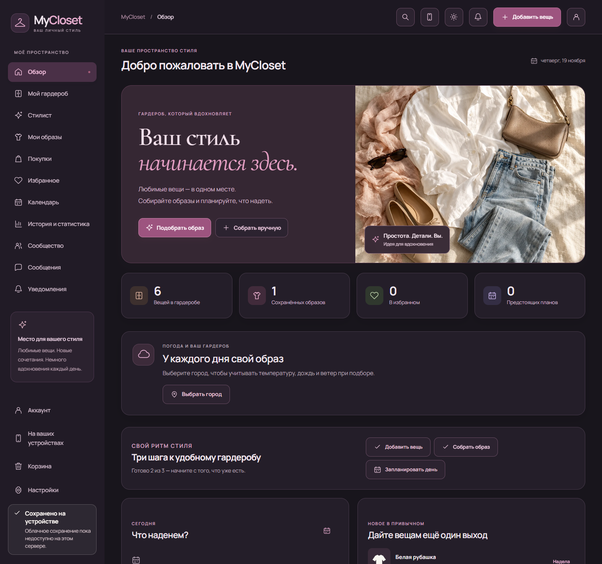
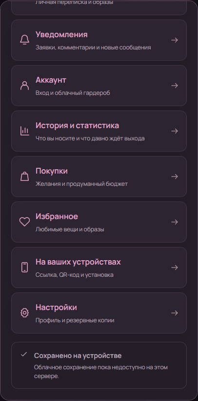
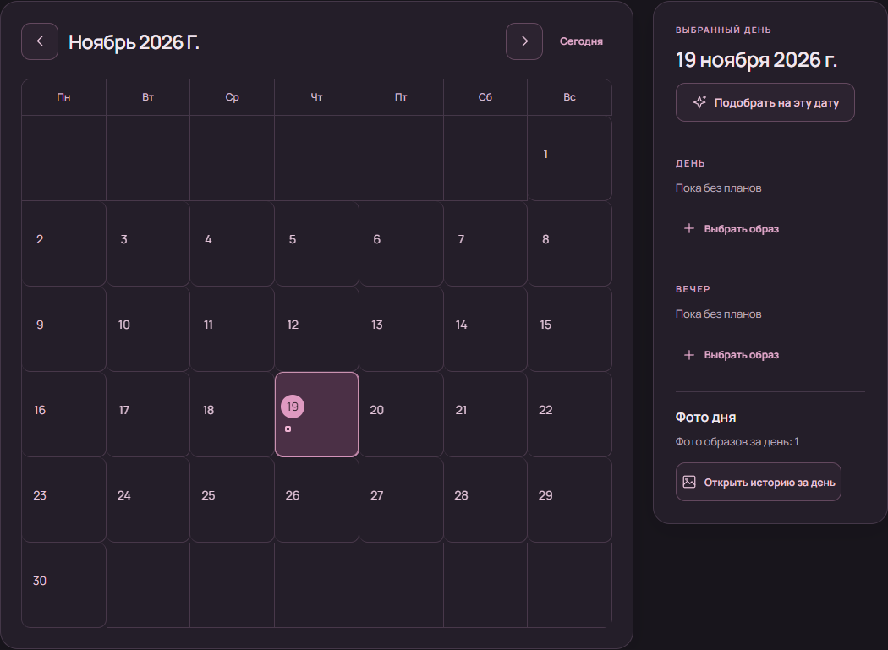
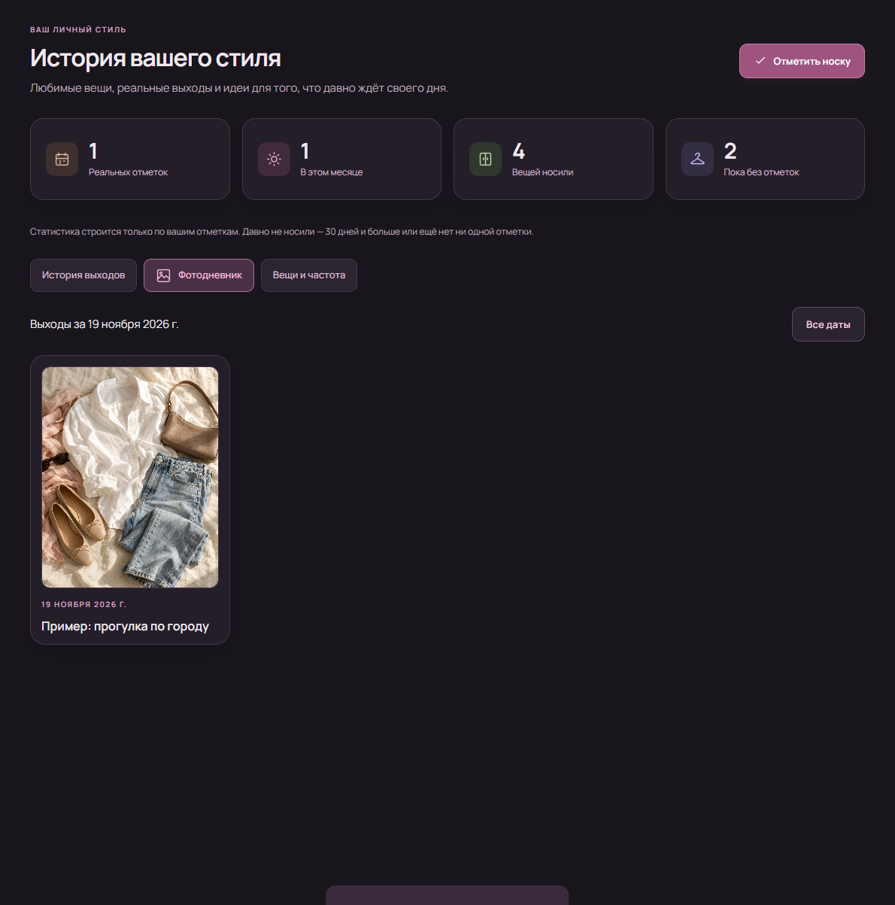
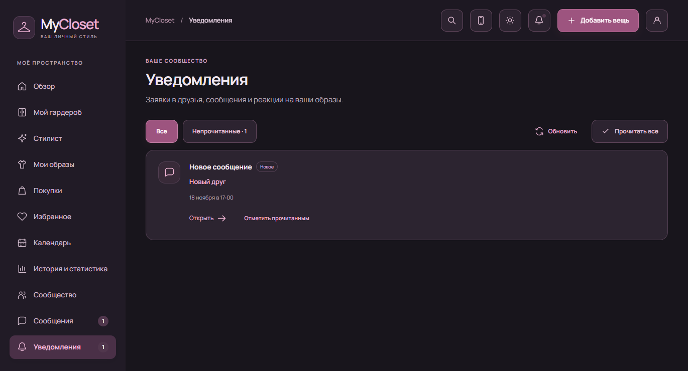
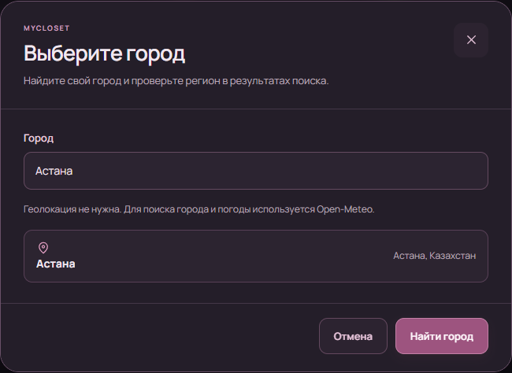

# MyCloset — инструкция по обновлению

В инструкции показано, как добавить вещи по фото, сохранить фото дня, настроить уведомления и выбрать город. На скриншотах использованы демонстрационные данные.

- [Меню и сохранение](#меню-и-сохранение)
- [Одна вещь по фото](#одна-вещь-по-фото)
- [Несколько вещей по фото](#несколько-вещей-по-фото)
- [Фото дня и фотодневник](#фото-дня-и-фотодневник)
- [Лента уведомлений](#лента-уведомлений)
- [Настройки уведомлений](#настройки-уведомлений)
- [Город и погода](#город-и-погода)

## Меню и сохранение

**На компьютере** прокрутите левое меню до конца. Под пунктом **«Настройки»** появится статус сохранения. На скриншоте он находится внизу слева.

**На телефоне** нажмите **«Ещё»** в нижнем меню и прокрутите список до конца. Там появится тот же статус.

| Что написано | Что это значит |
| --- | --- |
| **Сохранено на устройстве** | Гардероб записан в этом браузере. Нажмите на статус, чтобы открыть аккаунт и проверить облачное сохранение. |
| **Сохранено в аккаунте** | Облачная копия обновлена. На другом устройстве войдите с той же почтой. |
| **Только до закрытия страницы** | Гардероб открыт во временном режиме. Нажмите на статус и в блоке **«Данные и резервные копии»** нажмите **«Скачать резервную копию»** до закрытия вкладки. |
| **Не сохранено на устройстве** | Последнее изменение не записалось. Попробуйте сохранить его ещё раз. Если ошибка повторится, скачайте копию доступных данных через **«Настройки» → «Данные и резервные копии»**. |

Раздел **«Коллекции и поездки»** убран из меню, поиска и главной страницы. Если открыть его по старой ссылке, появится **«Мой гардероб»**. Ранее сохранённые записи входят в скачиваемую резервную копию. Там же находятся вещи, образы, планы и история носки с фотографиями.

Чтобы быстро найти вещь или образ, на компьютере нажмите лупу вверху, а на телефоне выберите **«Ещё» → «Найти в MyCloset»**. Введите часть названия, например «рубашка». Выберите **«Вещи»** или **«Образы»**, если хотите сузить выдачу.

## Одна вещь по фото

1. Нажмите **«Добавить вещь»**. Откроется окно **«Новая вещь»**.
2. В блоке **«Фотография»** выберите один файл JPEG, PNG или WebP до 12 МБ. Когда появится миниатюра, сайт начнёт анализировать фото.
3. Посмотрите блок **«Подсказки по фото»**. Строка **«Заполнено по фото»** перечислит поля, которые сайт уже заполнил. В зависимости от снимка это могут быть название, категория, тип вещи и цвет.
4. Проверьте результат. На скриншоте из снимка получились название **«Рубашка · синий»**, тип **«Рубашка»** и цвет **«Синий»**. Можно нажать на другую подсказку или изменить поле вручную. Кнопка **«Отменить автозаполнение»** возвращает значения, которые менял сайт, и сохраняет ваши правки.
5. Укажите название, категорию, хотя бы один цвет и один сезон. Размер можно вписать рядом с категорией. Бренд и материал находятся в блоке **«Детали вещи»**.
6. Нажмите **«Сохранить вещь»**. Карточка появится в **«Моём гардеробе»**.

**Если подсказки загружаются долго**, можно продолжить заполнять форму. При первом запуске браузер может скачать до 40 МБ для распознавания. Само фото анализируется в браузере. Если появится кнопка **«Повторить анализ»**, нажмите её или заполните поля сами. При замене фото в уже сохранённой вещи сайт предложит варианты, а поля изменятся, когда вы выберете подсказку или внесёте правку.

## Несколько вещей по фото

1. Откройте **«Мой гардероб»** и нажмите **«Несколько фото»**.
2. В окне **«Добавить несколько фотографий»** выберите до 20 снимков. Для каждого действует тот же лимит в 12 МБ и те же форматы, что для одной вещи.
3. Подождите, пока появятся карточки. Одна фотография создаёт одну карточку. Если название ещё не распознано, за основу берётся имя файла. Строка **«Автозаполнение применено к…»** показывает, сколько карточек сайт смог заполнить.
4. Если у нескольких вещей одинаковые параметры и вы хотите применить их **ко всему списку**, задайте категорию, цвета или сезоны в блоке **«Общие параметры»** и нажмите **«Применить ко всем карточкам»**. Например, можно выбрать **«Лето»** для всей загрузки.
5. Чтобы исправить только одну вещь, откройте под её миниатюрой **«Изменить параметры этой вещи»**. Проверьте название, категорию, цвет и сезон. Можно отменить автозаполнение одной карточки или всей загрузки.
6. Если снимок загрузился с ошибкой, нажмите **«Убрать карточку»** под ним. Кнопка **«Заменить список фотографий»** начинает загрузку заново для всего списка.
7. Нажмите **«Сохранить все»**. Число рядом с кнопкой показывает, сколько вещей вы добавляете. Все карточки должны быть готовы к сохранению.

## Фото дня и фотодневник

### Как открыть нужный день

- **Сегодня с главной.** На **«Обзоре»** прокрутите страницу до блока **«Что наденем?»** и нажмите **«Фото дня»**. Блок появится, когда в гардеробе есть хотя бы одна вещь.
- **Конкретная дата.** В **«Календаре»** нажмите на сегодняшний или прошедший день. В блоке **«Фото дня»** нажмите **«Отметить носку с фото»**, чтобы создать запись. Если за этот день уже есть запись, кнопка будет называться **«Открыть историю за день»**. Значок камеры на дате показывает, что за этот день сохранено фото.
- **Сразу из истории.** Откройте **«История и статистика»** и нажмите вверху **«Отметить носку»**.

### Как сохранить снимок

1. В окне **«Что вы надели?»** проверьте дату. В поле **«Сохранённый образ»** выберите готовый образ или пункт **«Выберу вещи вручную»**. При желании добавьте заметку.
2. В блоке **«Фото образа»** нажмите **«Выбрать фото»**. На телефоне можно нажать **«Снять фото»**, если кнопка доступна. Дождитесь появления миниатюры.
3. Нажмите **«Сохранить отметку»**. Запись появится в **«Истории выходов»**, а снимок — во вкладке **«Фотодневник»**. Отметку можно сохранить и без фотографии.

План в календаре — то, что вы собираетесь надеть. Отметка носки — то, что вы уже надели. Так можно оставить план на завтра и отдельно сохранить фото сегодняшнего образа.

### Как найти, заменить или убрать фото

- Откройте **«История и статистика» → «Фотодневник»** и нажмите на снимок, чтобы посмотреть его крупнее. Если открыли историю из календаря и хотите увидеть другие дни, нажмите **«Все даты»**.
- Если в старой записи ещё нет снимка, откройте **«История выходов»**, найдите запись и нажмите **«Добавить фото»**.
- Для замены нажмите **«Изменить фото» → «Выбрать другое фото» → «Сохранить фото»**.
- Чтобы убрать только снимок, нажмите **«Изменить фото» → «Убрать фото» → «Удалить фото из истории»**. Запись о том, что вы носили в этот день, останется.

Фотографии из дневника входят в резервную копию гардероба. При включённом облачном сохранении они доступны через ваш аккаунт.

## Лента уведомлений

1. Нажмите колокольчик вверху или пункт **«Уведомления»** в боковом меню. На телефоне этот пункт также есть в меню **«Ещё»**.
2. Войдите в аккаунт, если сайт попросит. На странице появятся события, например новое сообщение или заявка в друзья.
3. Выберите **«Все»** или **«Непрочитанные»**. Кнопка **«Открыть»**, если она есть, переведёт к связанному сообщению или другой странице.
4. Нажмите **«Отметить прочитанным»** у одного события или **«Прочитать все»** вверху списка. Чтобы проверить новые события, нажмите **«Обновить»**.

## Настройки уведомлений

Откройте **«Настройки»** и нажмите **«Уведомления»** в списке быстрых переходов. Здесь два блока, каждый со своей кнопкой сохранения.

### Какие события показывать внутри сайта

1. В блоке **«Уведомления на сайте»** выберите нужные категории. Доступны **«Заявки и дружба»**, **«Личные сообщения»**, **«Лайки»** и **«Комментарии»**.
2. Нажмите **«Сохранить»** в этом же блоке. Если сайт просит создать профиль сообщества, сначала заполните его.
3. Если хотите получать личные сообщения ещё и на экран телефона или компьютера, включите **«Личные сообщения»** также в блоке **«Уведомления на устройстве»**.

### Как получать уведомления при закрытой вкладке

1. В блоке **«Уведомления на устройстве»** включите **«Личные сообщения»**, **«Напоминать об образе на завтра»** или оба пункта.
2. Если включили напоминания, выберите **«Во сколько напоминать»**. Например, поставьте **20:00**, чтобы получить напоминание накануне вечером. Для этого образ на завтра должен быть сохранён в календаре аккаунта. Раскройте **«Часовой пояс»**, если нужно проверить местное время.
3. Нажмите **«Сохранить настройки»** и затем **«Включить уведомления»**. Когда браузер спросит, разрешите уведомления для MyCloset. Это разрешение выдаётся на каждом устройстве отдельно.
4. Чтобы выключить уведомления на этом устройстве, вернитесь в тот же блок и нажмите **«Отключить»**.

Если **«Включить уведомления»** неактивна, проверьте, выбрано ли хотя бы одно событие и сохранены ли изменения. Если браузер уже заблокировал уведомления, измените разрешение для MyCloset в настройках браузера. На iPhone, если сайт предлагает добавить MyCloset на экран **«Домой»**, сначала сделайте это и откройте сайт с нового значка.

## Город и погода

### Как выбрать город

1. На **«Обзоре»** найдите карточку **«У каждого дня свой образ»**. Нажмите **«Выбрать город»**. Если город уже выбран, нажмите **«Сменить город»**.
2. Введите название, например **«Астана»**, и нажмите **«Найти город»**. Поиск доступен от двух букв. Разрешать доступ к геолокации не нужно.
3. Нажмите на подходящую строку в списке. Сверьте город и страну или область под названием. После выбора окно закроется, город сохранится и сайт запросит прогноз.

### Что делать, если прогноза пока нет

- Если поиск не нашёл город, проверьте написание. Если в окне поиска указано, что сервис недоступен, попробуйте позже.
- Если город уже отображается, а **в карточке прогноза** показана ошибка или сообщение о лимите запросов, город сохранён. Нажмите **«Обновить»** в карточке позже.
- Чтобы подобрать образ сразу, откройте **«Стилист»**. В разделе **«Как учитывать погоду?»** выберите **«Вручную»** и введите ощущаемую температуру. Осадки и ветер можно указать по желанию. Можно также выбрать **«Без погоды»**. Затем нажмите **«Подобрать образ»**.
