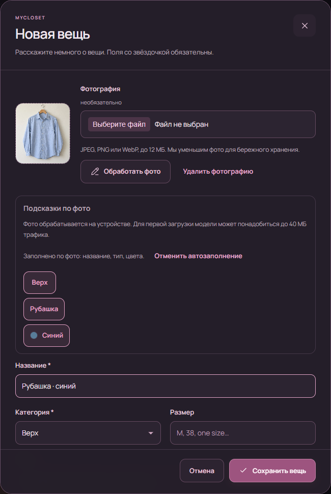
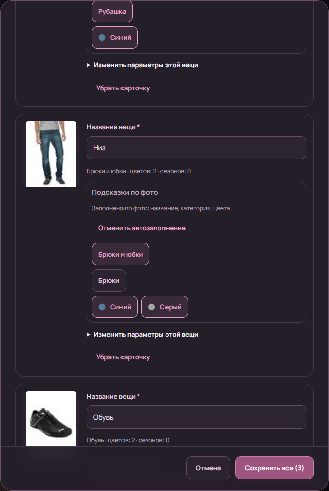
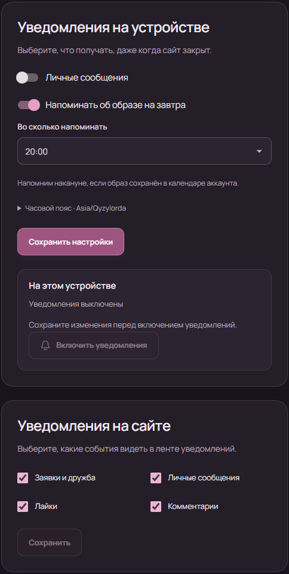

# Что изменилось в MyCloset

Скриншоты сделаны на демонстрационных данных.

## Обзор и боковое меню

Пункт **«Коллекции и поездки»** убран из бокового меню, мобильного меню **«Ещё»** и поиска. На главной больше нет карточки со списком вещей в поездку. Старая ссылка открывает **«Мой гардероб»**, а ранее сохранённые капсулы и поездки остаются в данных и резервных копиях.

Статус **«Сохранено на устройстве»** теперь внизу бокового меню на компьютере и в меню **«Ещё»** на телефоне. По нажатию открывается аккаунт с настройками синхронизации. Если браузер не может сохранить данные, статус ведёт к резервным копиям в настройках.

## Вещь по фотографии

1. Нажмите **«Добавить вещь»** и загрузите фотографию.
2. Анализ начнётся сам. Если модель уверена в результате, форма может заполнить категорию, тип вещи, цвета и название. В блоке **«Подсказки по фото»** можно выбрать другой вариант или нажать **«Отменить автозаполнение»**.
3. Проверьте поля, выберите сезон, при необходимости добавьте размер и материал и сохраните вещь.

Снимок анализируется в браузере. При первой загрузке модели может понадобиться до 40 МБ трафика. При редактировании существующей вещи анализ показывает подсказки, а правки в карточку вносите вы.

## Несколько вещей за один раз

Откройте **«Мой гардероб» → «Несколько фото»** и выберите до 20 фотографий JPEG, PNG или WebP размером до 12 МБ каждая. У каждой фотографии появится своя карточка. Анализ заполнит подходящие поля, а имя файла будет исходным вариантом названия. Проверьте карточки, исправьте нужные поля и нажмите **«Сохранить все»**. Правки можно внести по одной карточке или применить общие настройки ко всей партии.

## Фото дня и фотодневник

- **Обзор → «Что наденем?» → «Фото дня»** открывает историю за сегодня. Если отметки ещё нет, сразу откроется форма новой отметки.
- **Календарь → выбранная дата → «Фото дня»** открывает историю за день или позволяет отметить носку с фото. Точка на дате показывает, что за этот день есть снимок.
- **История и статистика → «Фотодневник»** показывает сохранённые фотографии. Снимок можно открыть крупно, добавить или заменить в записи. Если убрать фотографию, отметка носки останется.

Чтобы сохранить снимок, нажмите **«Отметить носку»**, выберите образ или вещи, в блоке **«Фото образа»** нажмите **«Выбрать фото»** и сохраните отметку. Фотографии входят в резервную копию гардероба и синхронизируются, если включено сохранение в аккаунт.

## Уведомления

Раздел **«Уведомления»** в боковом меню и по значку колокольчика показывает ленту событий. Там можно открыть событие или отметить его прочитанным.

Чтобы настроить уведомления, откройте **«Настройки» → «Уведомления»**. После входа доступны два блока.

- **Уведомления на устройстве.** Выберите личные сообщения и напоминания об образе на завтра. После включения напоминаний выберите время и при необходимости смените часовой пояс. Нажмите **«Сохранить настройки»**, затем **«Включить уведомления»** и разрешите их в браузере.
- **Уведомления на сайте.** Если создан профиль сообщества, можно выбрать, что появится в ленте: заявки и дружба, личные сообщения, лайки или комментарии.

В настройках также есть быстрые переходы к профилю, внешнему виду и резервным копиям.

## Город и погода

На **«Обзоре»** в карточке погоды нажмите **«Выбрать город»** или **«Сменить город»**. Например, введите «Астана», нажмите **«Найти город»** и выберите результат по региону. Поиск города и прогноз теперь показывают отдельные сообщения об ошибках. Если прогноз недоступен или сервис временно ограничил запросы, вернитесь к карточке позже и нажмите **«Обновить»**. Подобрать образ можно уже сейчас в разделе **«Стилист»** с режимом **«Вручную»** или **«Без погоды»**.
